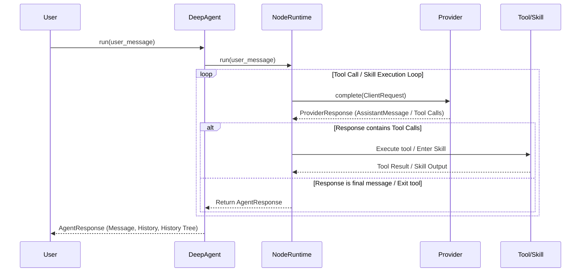

# Architecture & Core Concepts

`exmekh_lib` is a modular Python framework designed for building structured, reliable, and hierarchical Large Language Model (LLM) agents. It provides both low-level abstractions for LLM interaction (clients, messages, tools, and structured outputs) and high-level agent orchestration capabilities (hierarchical skill trees, scoped execution, dynamic capabilities loading, and history tree snapshotting).

---

## Core System Layers

The `exmekh_lib` codebase is organized into several distinct architectural layers:

```
+-----------------------------------------------------------------------+
|                           Application / CLI                           |
|                             (exmekh_lib.main)                                 |
+-----------------------------------------------------------------------+
                                   |
                                   v
+-----------------------------------------------------------------------+
|                      Hierarchical Agent Layer                         |
|                 (exmekh_lib.core.agents / DeepAgent / Node)                   |
+-----------------------------------------------------------------------+
         |                                                 |
         v                                                 v
+-----------------------+                         +---------------------+
| Capabilities Catalog  |                         |   LLM Client Layer  |
|  (HDS, Skills, Tools) |                         | (exmekh_lib.core.models.Client)
+-----------------------+                         +---------------------+
                                                           |
                                                           v
                                                  +---------------------+
                                                  |   Provider Layer    |
                                                  | (exmekh_lib.providers.Local)|
                                                  +---------------------+
```

### 1. Provider Layer (`exmekh_lib.interfaces.provider`, `exmekh_lib.providers`)
The provider layer defines standard interfaces for communicating with LLM backends.
- **[`Provider`](../src/exmekh_lib/interfaces/provider.py)**: Abstract base class defining `complete()` (unary completion) and `stream()` (event streaming).
- **[`LocalProvider`](../src/exmekh_lib/providers/local.py)**: Concrete provider for local LLM engines (llama.cpp, Ollama, vLLM) or OpenAI-compatible endpoints, supporting both Chat Completions (`/v1/chat/completions`) and Responses APIs (`/v1/responses`).

### 2. LLM Client Layer (`exmekh_lib.core.models.client`)
The client layer provides a high-level API over raw providers:
- **[`Client`](../src/exmekh_lib/core/models/client.py)**: Manages model interaction, system prompts, message history, function tools registration, and response coercion.
- **Structured Outputs**: Supports `client.call_structured(...)` to validate LLM output against Pydantic models with strict or non-strict JSON schema validation.

`ProviderResponse.history_messages()` exposes the transcript evidence to retain.
The client records that public result without interpreting provider cancellation
details. A completed response superseded by steering remains evidence with
cancelled, unexecuted tool receipts; its calls are never dispatched. An actually
interrupted generation follows the interruption protocol instead.

### 3. Capabilities System (`exmekh_lib.core.agents.capabilities`)
Capabilities are directory-based resources that specify an agent's knowledge, skills, system prompts, and tools:
- **HDS (Hierarchical Domain Specification)**: System prompt and agent personality defined in Markdown (e.g., `main.md`).
- **Deep Skills**: Specialized skill instructions written in Markdown with metadata frontmatter.
- **Function Tools**: Python functions decorated with `@deep_tool` or `@exit_tool` in `main.py` files.
- **Exit Tools & Skills**: Formal mechanisms allowing agents to navigate out of nested skill contexts.

### 4. Hierarchical Agent Layer (`exmekh_lib.core.agents.deep_agent`)
The agent layer orchestrates multi-step, multi-depth agent execution:
- **[`Node`](../src/exmekh_lib/core/agents/node/node.py)**: Defines a node in the agent hierarchy, binding a capabilities directory and HDS system prompt.
- **[`DeepAgent`](../src/exmekh_lib/core/agents/deep_agent/deep_agent.py)**: Initializes and executes a root `Node`, recursively loading capabilities and managing runtime cycles.
- **Dual History Management**: Maintains both linear execution history and hierarchical `history_tree` snapshots as skills transition.
- **Real-Time Streaming**: Emits granular provider stream events (tokens, reasoning content) alongside execution events (tool states, depth, skill path).

---

## Agent Lifecycle & Execution Flow

Below is the step-by-step lifecycle of a `DeepAgent` request:



1. **Initialization**: `DeepAgent` validates workspace parameters (`work_root`), checks node hierarchies for cycles, and loads capabilities.
2. **Message Processing**: The input message is wrapped in a `ClientRequest` with system messages constructed from the active HDS and skill catalog.
3. **Execution Loop**: The agent calls the provider. If the model emits tool calls, the runtime executes the requested python function tools or transitions into sub-skills.
4. **Completion**: Execution finishes when the agent receives a final textual response or triggers an exit tool/skill, returning an [`AgentResponse`](../src/exmekh_lib/core/agents/deep_agent/agent_response.py).
