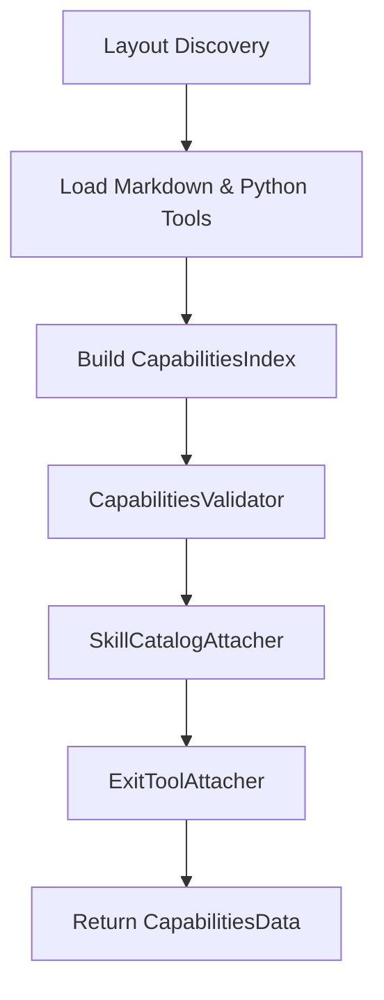

# Capabilities System & Catalog

The `qs` capabilities framework allows agent behaviors, system prompts, skills, and tools to be modularly defined on the filesystem in Markdown and Python files, and dynamically loaded at runtime.

---

## Capabilities Directory Layout

A capability repository follows a structured directory layout under a `capabilities/` folder:

```
capabilities/
├── hds/
│   └── main.md                 # Hierarchical Domain Specification (Root System Prompt)
├── deep-skill/
│   ├── mock-skill.md           # Domain skill definition
│   └── nested-skill.md         # Nested sub-skill definition
├── exit-skill/
│   └── finish.md               # Skill to exit or complete an agent run
├── tools/
│   ├── mock-tool/
│   │   └── main.py             # Entrypoint with @deep_tool function
│   └── shared-tool/
│       └── main.py
└── exit-tool/
    └── finish/
        └── main.py             # Entrypoint with @exit_tool function
```

The [`CapabilitiesLayout`](file:///c:/Users/danie/Desktop/qs/qs/src/qs/core/agents/capabilities/layout.py) class verifies directory integrity and automatically creates missing subfolders when initialized.

---

## Resource Types ([`CapabilityType`](file:///c:/Users/danie/Desktop/qs/qs/src/qs/core/agents/capabilities/layout.py))

### 1. HDS (Hierarchical Domain Specification)
HDS files are Markdown files located in `capabilities/hds/`. They define the base identity, prompt, available tools, and exit strategy for a [`Node`](file:///c:/Users/danie/Desktop/qs/qs/src/qs/core/agents/node/node.py).

```markdown
---
name: main
description: Main agent system prompt.
tools:
  - mock-tool
skills:
  - mock-skill
exit-skill: finish
---
# Main System Agent

You are the lead orchestrator agent responsible for analyzing user commands and delegating to tools and sub-skills.
```

### 2. Deep Skills (`deep-skill`)
Deep skills in `capabilities/deep-skill/` allow an agent to switch into a focused execution mode with dedicated instructions and subset of tools.

```markdown
---
name: mock-skill
description: Performs refactoring and codebase analysis.
tools:
  - read_workspace_file
skills:
  - nested-skill
exit-skill: finish
---
# Refactoring Skill Instructions

Follow these guidelines when refactoring code:
1. Always preserve public API contracts.
2. Run test suites before and after changes.
```

### 3. Exit Skills & Exit Tools (`exit-skill`, `exit-tool`)
Exit mechanisms allow an agent to terminate its current execution loop or signal task completion.
- **Exit Skill**: Defined in `capabilities/exit-skill/*.md`.
- **Exit Tool**: Defined in `capabilities/exit-tool/*/main.py` using the `@exit_tool` decorator.

```python
from qs.core.agents.exit_tool import exit_tool


@exit_tool(description="Signals that the agent task is finished.")
def finish(reason: str) -> str:
    return f"Task completed: {reason}"
```

---

## Capability Loading & Validation Pipeline

When [`Capabilities.load(...)`](file:///c:/Users/danie/Desktop/qs/qs/src/qs/core/agents/capabilities/capabilities.py) is called, it executes a multi-stage validation and attachment pipeline:



1. **Discovery & Parsing**: Scans filesystem, parses YAML frontmatter in Markdown files, and imports Python modules under `tools/` and `exit-tool/`.
2. **Index Building**: Indexes resources by name, type, and path using `CapabilitiesIndex`.
3. **Validation (`CapabilitiesValidator`)**: Ensures:
   - Referenced tools and skills exist in the index.
   - No duplicate tool or skill names across capability folders.
   - Skill graphs are acyclic.
4. **Catalog Attachment (`SkillCatalogAttacher`)**: Injects dynamic descriptions of accessible sub-skills into HDS and skill system prompts.
5. **Exit Tool Attachment (`ExitToolAttacher`)**: Attaches declared exit tools to corresponding exit skills.
