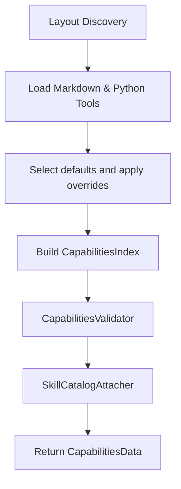

# Capabilities System & Catalog

The `qs` capabilities framework allows agent behaviors, system prompts, skills, and tools to be modularly defined on the filesystem in Markdown and Python files, and dynamically loaded at runtime.

---

## Capabilities Directory Layout

A capability repository follows a structured directory layout under a `capabilities/` folder:

```
capabilities/
├── hds/
│   └── main.md                 # Hierarchical Domain Specification (Root System Prompt)
├── deep-skill/
│   ├── mock-skill.md           # Domain skill definition
│   └── nested-skill.md         # Nested sub-skill definition
├── tools/
│   ├── mock-tool/
│   │   └── main.py             # Entrypoint with @deep_tool function
│   ├── shared-tool/
│   │   └── main.py
│   └── bash/
│       └── main.py             # Runtime-bound harness tool
└── exit-tool/
    └── finish/
        ├── main.py             # Entrypoint with @exit_tool function
        └── instructions.md     # Plain Markdown exit instructions
```

The [`CapabilitiesLayout`](file:///c:/Users/danie/Desktop/qs/qs/src/qs/core/agents/capabilities/layout.py) class verifies directory integrity and automatically creates missing subfolders when initialized.

Bundled runtime tools also live under `src/qs/capabilities/tools/<name>/main.py`:
`bash`, `get_execution_history`, `search_tool_outputs`, `read_tool_output`,
`control_tool_execution`, and `call_sub_agent`. They need node-local state, so
`NodeRuntime` binds them after loading the ordinary `@deep_tool` resources.
The ordinary tool loader excludes only these bundled runtime directories;
application capability roots still load their own tools through `@deep_tool`.
The bundled root is resolved relative to the `qs` package, like HDS, deep
skills, and exit tools.

## Per-node default capabilities

`DefaultCapabilities` selects bundled resources independently for each `Node`.
Its default is `mocks=False, harness=True`. `Node` accepts
`capabilities_paths=None`; when `DefaultCapabilities` is supplied, it adds the
bundled directory exposed by `DefaultCapabilities.capabilities_path` automatically.
The bundled directory can also appear explicitly in `capabilities_paths` and is
loaded only once. A harness-only node needs an application HDS in
`capabilities_paths` (or an HDS override). Without `DefaultCapabilities`, nodes
with application paths keep their existing behavior; a node with no paths loads
the bundled directory in full.

| Group | Bundled names |
| --- | --- |
| Mock | HDS `main`, `mock-sub-agent`; skills `mock-skill`, `nested-skill`; tools `mock-tool`, `mock-sub-tool`, `nested-sub-tool`, `shared-tool` |
| Harness | Exit tool `exit_agent`; memory tools `get_execution_history`, `search_tool_outputs`, `read_tool_output`; execution control `control_tool_execution`; Bash tool `bash`; delegation tool `call_sub_agent` on nodes with children |

There are currently no bundled harness skills. Group switches select all names
in that group. `include` and `exclude` take names that adjust the switches;
`overrides` accepts `ToolOverride(target_name, replacement_name)` and
`DeepSkillOverride(target_name, replacement_name)`. The replacement name refers
to a resource loaded from any `capabilities_paths` directory, including the
bundled directory. The target may be a bundled or application tool or skill;
runtime harness tools can also be tool targets. The replacement is exposed under
the target name in this node. Missing targets or replacement names, and
ambiguous replacement names, raise errors during loading. An override selects a
bundled target even when its group is off. An explicit exclusion cannot also be
included or overridden.

```python
from pathlib import Path

from qs.core.agents.node import (
    DeepSkillOverride,
    DefaultCapabilities,
    Node,
    ToolOverride,
)

node = Node(
    capabilities_paths=[Path("my-app/capabilities")],
    name_hds="main",
    default_capabilities=DefaultCapabilities(
        mocks=True,
        harness=True,
        exclude={"read_tool_output"},
        overrides=[
            ToolOverride("mock-tool", "example-echo"),
            DeepSkillOverride("mock-skill", "my-skill"),
        ],
    ),
)
```

Here `my-app/capabilities` defines the tool `example-echo` and the deep skill
`my-skill`. The tool runs as `mock-tool`, and the skill opens as `mock-skill`.
Named overrides also work when the target is an application tool or skill. The
target name stays stable in provider schemas, allowed scopes, and calls. The
existing mapping form remains available for direct Python object replacements.

For a smaller selection, use `mocks=False` and `include={"mock-tool"}` with an
application HDS that declares `mock-tool` in `sub-tools`. Likewise,
`harness=False` with `include={"exit_agent", "get_execution_history"}` keeps
only those harness capabilities. Each HDS must still name a selected exit tool;
an application can provide a different one. `call_sub_agent` requires children
and cannot be overridden on a leaf node.

Composition happens before reference validation and catalog attachment. A
selected HDS or skill that references an excluded capability fails loading with
the invalid reference named; no dependencies are silently re-enabled. Active
names must be unique across application and bundled resources unless the name
is replaced in `overrides`. Only selected runtime tools enter the provider tool
list and every skill scope. Internal execution history and caching continue when
their reader tools are excluded.

---

## Resource Types ([`CapabilityType`](file:///c:/Users/danie/Desktop/qs/qs/src/qs/core/agents/capabilities/layout.py))

### 1. HDS (Hierarchical Domain Specification)
HDS files are Markdown files located in `capabilities/hds/`. They define the base identity, prompt, available tools, and exit strategy for a [`Node`](file:///c:/Users/danie/Desktop/qs/qs/src/qs/core/agents/node/node.py).

```markdown
---
description: Main agent system prompt.
exit-tool: exit_agent
agent-context-id: main
sub-tools:
  - mock-tool
sub-skills:
  - mock-skill
---
# Main System Agent

You are the lead orchestrator agent responsible for analyzing user commands and delegating to tools and sub-skills.
```

- **`agent-context-id`** (optional): Non-empty string identifying the agent context for inference engines like DS4. If omitted, defaults to the HDS file name (e.g. `main`). In DS4, this opaque key binds live KV cache, system prefix frontiers, and automatic context checkpointing/restoring during sub-agent delegation.

### 2. Deep Skills (`deep-skill`)
Deep skills in `capabilities/deep-skill/` allow an agent to switch into a focused execution mode with dedicated instructions and subset of tools.

```markdown
---
description: Performs refactoring and codebase analysis.
sub-tools:
  - read_workspace_file
sub-skills:
  - nested-skill
---
# Refactoring Skill Instructions

Follow these guidelines when refactoring code:
1. Always preserve public API contracts.
2. Run test suites before and after changes.
```

### 3. Exit Tools (`exit-tool`)
Each HDS must select exactly one exit tool by its exposed name (`exit-tool: exit_agent`). Multiple HDS files can select the same exit tool. The folder name is only the default tool name when `name` is omitted from the decorator.

```python
from qs.core.agents.exit_tool import ExitToolData, exit_tool


@exit_tool(
    name="exit_agent",
    description="Return the current skill result to its caller.",
    instructions_path="instructions.md",
)
def finish(text: str, items: list[str]) -> ExitToolData:
    return ExitToolData(text=text, items=items)
```

`instructions_path` is required and accepts a string or `Path`. Relative paths are relative to `main.py`, not the working directory; absolute paths are also supported. The loader requires a readable `.md` file, rejects symbolic links and blank or whitespace-only content, and reads it once during capability loading. File errors abort loading and unload imported modules.

The file is plain Markdown, without YAML parsing or skill metadata:

```markdown
When the current skill is complete, call {{!exit_agent}}.
Put the result in text and saved output IDs to include in items (or items=[]).
```

For the current `items` contract, XML placement, and correctable errors, see
[Exit Tool Items](10-exit-tool-items.md).

References such as `{{!exit_agent}}` are replaced by capability names and validated after all configured capability roots have loaded. Unknown references fail loading. References do not grant permission to call a capability.

The selected tool's instructions are appended after each normal skill's body and catalog, inside `<exit-tool name="exit_agent">...</exit-tool>`. For nodes initialized at positive depth, they also appear in the initial system prompt. Instructions have no callable capability or separate catalog entry, and are not added to the tool's parameter schema.
The runtime also appends common output-selection guidance to every HDS system
prompt; its exact text and purpose are documented in
[Exit Tool Items](10-exit-tool-items.md).

Only the selected exit tool is added to `allowed_tools`, and only at `depth > 0`. It returns from the current skill; it does not terminate every enclosing skill. `ExitToolData`, history compaction, and saved tool results keep their existing behavior.

#### Migration from exit skills

Move the instruction body into the exit tool directory, remove the old YAML front matter, set `instructions_path` on the decorator, and replace the HDS field `exit-skill` with `exit-tool` using the tool's exposed name. Remove the old `exit-skill` directory and any calls that requested its instructions. The loader rejects the legacy directory with a migration hint. Exit tool names must be unique across all roots and must not collide with tools, deep skills, or HDS names.

---

## Capability Loading & Validation Pipeline

When [`Capabilities.load(...)`](file:///c:/Users/danie/Desktop/qs/qs/src/qs/core/agents/capabilities/capabilities.py) is called, it executes a multi-stage validation and attachment pipeline:



1. **Discovery & Parsing**: Scans filesystem, parses YAML frontmatter in HDS and deep-skill files, reads plain exit instruction Markdown, and imports Python modules under `tools/` and `exit-tool/`.
2. **Optional Default Composition**: Selects bundled resources and applies per-node named or object overrides before indexing. Without `DefaultCapabilities`, this step leaves loaded resources unchanged.
3. **Index Building**: Indexes resources by exposed name within each capability type using `CapabilitiesIndex`.
4. **Validation (`CapabilitiesValidator`)**: Ensures:
   - Referenced tools and skills exist in the index.
   - No duplicate tool or skill names across capability folders.
   - Each HDS selects an existing exit tool; exit instruction references resolve.
5. **Catalog Attachment (`SkillCatalogAttacher`)**: Adds descriptions of declared sub-skills and tools to deep-skill catalogs.
6. **Runtime Composition**: The HDS-selected exit tool supplies instructions when a skill is opened.
