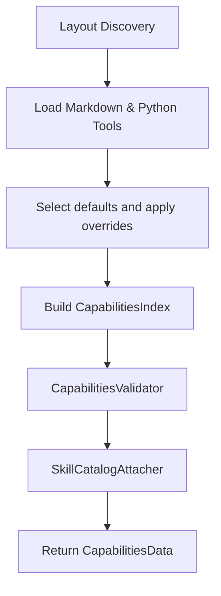

# Capabilities System & Catalog

The `exmekh_lib` capabilities framework allows agent behaviors, system prompts, skills, and tools to be modularly defined on the filesystem in Markdown and Python files, and dynamically loaded at runtime.

---

## Capabilities Directory Layout

A capability repository follows a structured directory layout under a `capabilities/` folder:

```
capabilities/
├── hds/
│   └── main.md                 # Hierarchical Domain Specification (Root System Prompt)
├── deep-skill/
│   ├── deep-thinking.md        # Research and reasoning skill
│   └── file-processing.md      # Workspace file skill
├── tools/
│   ├── calculate/
│   │   └── main.py             # Entrypoint with @deep_tool function
│   ├── search-web/
│   │   └── main.py
│   └── bash/
│       ├── main.py             # Decorated entrypoint
│       ├── bash_tool.py        # Runtime tool wrapper
│       └── bash_process.py     # Bash process lifecycle
└── exit-tool/
    └── finish/
        ├── main.py             # Entrypoint with @exit_tool function
        └── instructions.md     # Plain Markdown exit instructions
```

The [`CapabilitiesLayout`](../src/exmekh_lib/core/agents/capabilities/layout.py) class verifies directory integrity and automatically creates missing subfolders when initialized.

Bundled runtime tools also live under `src/exmekh_lib/capabilities/tools/<name>/main.py`:
`bash`, `get_execution_history`, `search_tool_outputs`, `read_tool_output`,
`control_tool_execution`, and `call_sub_agent`. They need node-local state, so
the node runtime binds their decorated entrypoints to node-local operations
after loading the ordinary `@deep_tool` resources. Search, history rendering,
and output reading live with their tool implementations. Class-only modules
use the class name in snake case (for example, `bash_tool.py`). Tool factories
live in `tool.py` next to their decorated entrypoints. The ordinary tool
loader excludes only these bundled runtime directories; application capability
roots still load their own tools through `@deep_tool`.
The bundled root is resolved relative to the `exmekh_lib` package, like HDS, deep
skills, and exit tools.

## Per-node default capabilities

`Node(default_capabilities=True)` enables the standard bundled capabilities;
with no application paths it also selects the bundled `main` HDS.
`Node(default_capabilities=False)` loads only the application roots, including
their own HDS and exit tool, and adds no runtime tools. `None` preserves the
legacy behavior: application roots are loaded as supplied, runtime tools are
added, and omitting the paths loads the bundled root in full.

For detailed selection, use the frozen names dataclass from `config.default_capabilities`:

```python
from pathlib import Path
from exmekh_lib.config.default_capabilities import DEFAULT_CAPABILITIES as defaults
from exmekh_lib.core.agents.node import DefaultCapabilities, Node, ToolOverride

node = Node(
    [Path("my-app/capabilities")],
    name_hds="application",
    default_capabilities=DefaultCapabilities(
        exclude={defaults.bash, defaults.delete_file},
        overrides=[ToolOverride(defaults.search_web, "company-search")],
    ),
)
```

`DefaultCapabilityNames` exposes all shipped HDS, skill, exit and tool names
as attributes; the values remain strings, so existing string-based selection
and overrides work unchanged. `DefaultCapabilities.catalog` is a read-only
mapping whose entries describe each name's kind, Python resource type, required
dependencies and whether it is bound by the runtime. `harness=False` starts from
an empty preset, after which `include` and overrides select individual resources.
An explicit exclusion conflicting with an inclusion or override is an error.

After initialization, `node.get_capability_inventory()` returns structured
`CapabilityInventory` data, including `selected_names` and entries with `kind`,
`dependencies`, `replacement`, `direct` and `reachable`. Availability is measured
from the node's initial HDS scope; a tool can be selected without being reachable
through that HDS. `call_sub_agent` appears only when actually bound to children.
The inventory is a Python API and makes no model request.

`DefaultCapabilities` selects bundled resources independently for each `Node`.
Its default is `harness=True`. The bundled `main` HDS uses only real harness
skills. Select it explicitly with `include={"main"}` when using defaults without
an application HDS. `Node` accepts
`capabilities_paths=None`; when `DefaultCapabilities` is supplied, it adds the
bundled directory exposed by `DefaultCapabilities.capabilities_path` automatically.
The bundled directory can also appear explicitly in `capabilities_paths` and is
loaded only once. A node using defaults can provide its own HDS or select
the bundled `main` explicitly. Without `DefaultCapabilities`, nodes
with application paths keep their existing behavior; a node with no paths loads
the bundled directory in full.

| Group | Bundled names |
| --- | --- |
| Harness | Skill `deep-thinking` with web, calculation, date/time, and logic tools; exit tool `exit_agent`; memory tools `get_execution_history`, `search_tool_outputs`, `read_tool_output`; execution control `control_tool_execution`; skill `file-processing` with file analysis `inspect-file`; Bash tool `bash`; delegation tool `call_sub_agent` on nodes with children |

The `file-processing` skill must be declared in the application HDS
`sub-skills`; the bundled main HDS already declares it. Its `inspect-file`
tool is available inside that skill. See
[Workspace File Inspection](14-file-inspection.md) for supported formats and limits.

The harness switch selects all harness names. `include` and `exclude` take names
that adjust that selection;
`overrides` accepts `ToolOverride(target_name, replacement_name)` and
`DeepSkillOverride(target_name, replacement_name)`. The replacement name refers
to a resource loaded from any `capabilities_paths` directory, including the
bundled directory. The target may be a bundled or application tool or skill;
runtime harness tools can also be tool targets. The replacement is exposed under
the target name in this node. Missing targets or replacement names, and
ambiguous replacement names, raise errors during loading. An override selects a
bundled target even when the harness switch is off. An explicit exclusion cannot also be
included or overridden.

```python
from pathlib import Path

from exmekh_lib.core.agents.node import (
    DeepSkillOverride,
    DefaultCapabilities,
    Node,
    ToolOverride,
)

node = Node(
    capabilities_paths=[Path("my-app/capabilities")],
    name_hds="main",
    default_capabilities=DefaultCapabilities(
        harness=True,
        exclude={"read_tool_output"},
        overrides=[
            ToolOverride("search-web", "company-search"),
            DeepSkillOverride("deep-thinking", "my-research"),
        ],
    ),
)
```

Here `my-app/capabilities` defines the tool `company-search` and the deep skill
`my-research`. The tool runs as `search-web`, and the skill opens as `deep-thinking`.
Named overrides also work when the target is an application tool or skill. The
target name stays stable in provider schemas, allowed scopes, and calls. The
existing mapping form remains available for direct Python object replacements.

To customize only the hooks of a selected bundled tool, pass `tool_hooks`.
`ToolHooks` accepts the existing `BeforeTool` and `AfterTool` interfaces:

```python
from typing import Any

from exmekh_lib.core.agents.node import DefaultCapabilities, ToolHooks
from exmekh_lib.interfaces.tool_hook import (
    AfterTool,
    BeforeTool,
    ToolArguments,
    ToolContext,
)


class NormalizeCommand(BeforeTool):
    def handle(self, context: ToolContext) -> ToolArguments:
        return ToolArguments({"command": context.arguments["command"].strip()})


class TrimOutput(AfterTool):
    def handle(self, context: ToolContext, result: Any) -> Any:
        return {**result, "stdout": result["stdout"].strip()}


defaults = DefaultCapabilities(
    tool_hooks={
        "bash": ToolHooks(before=NormalizeCommand(), after=TrimOutput()),
        "read-web-page": ToolHooks(after=None),
    },
)
```

Omitting a field preserves its original hook; an explicit `None` removes it;
an instance replaces it. Hooks are applied after object or named overrides,
under the target's exposed name, and are not automatically chained. This works
for loaded tools, runtime harness tools, `call_sub_agent`, and exit tools.
Tools retain their signatures, cache policies, and specialized execution behavior.
Runtime overrides also retain the default tool's execution restrictions: control,
memory, and delegation tools stay synchronous even if their replacement supports
background execution.
When an application tool has the same name as a bundled override target, the
bundled tool supplies the execution restrictions and interactive contract,
regardless of capability path order.
For direct Python tool objects, `tool.with_hooks(ToolHooks(after=None))` returns
a copy with the same rules.

Hook configuration does not select capabilities. Unknown names, HDS or skill
targets, and unselected or excluded tools raise errors at configuration time.
Configuring `call_sub_agent` hooks on a node without children raises an error
during initialization. Tools are copied without changing shared overrides;
the supplied hook instances are reused. Use separate instances when a hook
needs mutable state specific to one node. See
[tool hook execution](03-tools-and-structured-outputs.md#before-and-after-hooks) for the
argument and result contracts.

For a smaller selection, `harness=False` with
`include={"exit_agent", "get_execution_history"}` keeps only those harness
capabilities. Each HDS must still name a selected exit tool;
an application can provide a different one. `call_sub_agent` requires children
and cannot be overridden on a leaf node.

Composition happens before reference validation and catalog attachment. A
selected HDS or skill that requires an excluded capability fails loading with
the invalid reference named; no dependencies are silently re-enabled. Optional
declarations are filtered instead, as described below. Active
names must be unique across application and bundled resources unless the name
is replaced in `overrides`. Only selected runtime tools enter the provider tool
list and every skill scope. Internal execution history and caching continue when
their reader tools are excluded.

### Required and optional declarations

`sub-tools` and `sub-skills` remain required. Use `optional-sub-tools` and
`optional-sub-skills` for capabilities that should be exposed only when loaded:

```yaml
sub-tools:
  - inspect-file
  - read-file
optional-sub-tools:
  - delete-file
optional-sub-skills:
  - deep-thinking
```

Required and optional declarations must not overlap. Optional application
extensions may be absent, while bundled names are discoverable in the catalog.
These declarations grant scope access only to resources that are present;
neither optional declarations nor conditional text load a resource implicitly.
The bundled `main`, `deep-thinking` and `file-processing` use optional components.
The original bundled `read-file` requires `inspect-file`; `edit-file` requires
both. Excluding a prerequisite while retaining its dependent fails with the
dependency and correction in the error. Replacements define their own dependency
behavior; their compatible runtime contracts still apply where required.

### Conditional instructions

The same renderer handles harness guidance, HDS and skill Markdown bodies,
skill descriptions, tool descriptions and exit instructions:

```xml
<if-tool name="bash">Use {{!bash}} for shell work.</if-tool>
<if-skill name="file-processing">Open {{!file-processing}} for file operations.</if-skill>
<if-tool name="read-file" scope="reachable">A file reader is reachable through a skill.</if-tool>
<if-tool name="calculate" scope="selected">The calculation capability is installed.</if-tool>
<if-tool any-of="logic-check logic-consistency logic-counterexample">Shared formula instructions.</if-tool>
```

`scope="direct"` is the default and tests whether the capability can be called
in that scope. `reachable` also follows declared descendant skills, with cycle
protection. `selected` tests presence in the resolved node, without granting
permission to call it. Skill-entry rendering uses the actual inherited tool
scope, including `inherits-parent-tools`; reopening or nesting evaluates the
current path again. The selected exit tool becomes directly available inside
skills and at positive initial depth.
At the root, the exit tool is reachable through any reachable skill even when
it cannot be called directly there.

Use `any-of="name1 name2"` instead of `name` to show shared instructions when at
least one of the listed capabilities is available in the chosen scope. Names are
separated by whitespace and all must be known, even if another name already
matches. `name` and `any-of` are mutually exclusive; an empty list is invalid.
The same syntax applies to `<if-skill>`.

Conditions can nest. The runtime removes inactive blocks and strips active
condition tags before sending instructions to the model. It preserves the
remaining Markdown and arbitrary XML verbatim; fenced code, inline code and
HTML comments are literal, including example condition tags and references.
Unclosed code fences and comments remain literal through the end of the document.
Only the reserved condition tags are parsed, rather than parsing a whole
Markdown document as XML. Unknown condition names, invalid attributes/scopes
and unmatched tags fail explicitly, including inside inactive conditions.
Names declared as optional application extensions are known even when absent.
Only references in active instruction text are resolved and validated.

Built-in descriptions and catalogs are rendered after selection and override.
Removing `delete-file`, for example, removes its declaration, catalog entry,
skill instructions and cross-references from the edit tool's description.
Conditions describe availability; they do not infer the semantics of a new
implementation. Supply updated skill/HDS instructions when an override changes
the workflow expected by existing instructions.

### Overrides used by the runtime

Named and Python-object overrides keep the target's exposed name and use the
replacement's signature, description, hooks and cache policy. Original
synchronous and interactive execution restrictions are preserved. Each node
gets its own composed resource copies.

Two tools also have a checked automatic-call contract:

| Target | Required callable contract | Result after hooks |
| --- | --- | --- |
| `read_tool_output` | Accept keyword `output_id`, with optional `cursor` and `summary_mode`, and no extra mandatory parameters | `PreformattedToolResult` |
| `inspect-file` | Accept keyword `path` with no extra mandatory parameters | `InspectionReport`, or an explicit error dictionary with `ok=False` |

Incompatible signatures fail during initialization; incompatible results become
ordinary reported tool failures. Inspection reports must retain their provenance
to satisfy read prerequisites. These checks enforce the call protocol, not the
truth or completeness of an implementation's result. The exit tool retains its
existing `ExitToolData` checks. Other tool overrides can change their business
arguments; consumers' instructions must be updated accordingly.

Disabling a model-facing runtime reader does not disable internal caching or
history, and the explicit Python `Node.read_tool_output` and execution-control
APIs remain available to the application. Background work still follows the
execution protocol, but instructions advertise only the selected retrieval and
control tools; do not assume a removed tool is available for later recovery.

---

## Resource Types ([`CapabilityType`](../src/exmekh_lib/core/agents/capabilities/layout.py))

### 1. HDS (Hierarchical Domain Specification)
HDS files are Markdown files located in `capabilities/hds/`. They define the base identity, prompt, available tools, and exit strategy for a [`Node`](../src/exmekh_lib/core/agents/node/node.py).

```markdown
---
description: Main agent system prompt.
exit-tool: exit_agent
agent-context-id: main
sub-tools:
  - calculate
sub-skills:
  - deep-thinking
---
# Main System Agent

You are the lead orchestrator agent responsible for analyzing user commands and delegating to tools and sub-skills.
```

- **`agent-context-id`** (optional): Non-empty string identifying the agent context for inference engines like DS4. If omitted, defaults to the HDS file name (e.g. `main`). In DS4, this opaque key binds live KV cache, system prefix frontiers, and automatic context checkpointing/restoring during sub-agent delegation.

### 2. Deep Skills (`deep-skill`)
Deep skills in `capabilities/deep-skill/` allow an agent to switch into a focused execution mode with dedicated instructions and subset of tools.

```markdown
---
description: Performs refactoring and codebase analysis.
sub-tools:
  - read_workspace_file
sub-skills:
  - file-processing
---
# Refactoring Skill Instructions

Follow these guidelines when refactoring code:
1. Always preserve public API contracts.
2. Run test suites before and after changes.
```

### 3. Exit Tools (`exit-tool`)
Each HDS must select exactly one exit tool by its exposed name (`exit-tool: exit_agent`). Multiple HDS files can select the same exit tool. The folder name is only the default tool name when `name` is omitted from the decorator.

```python
from exmekh_lib.core.agents.exit_tool import ExitToolData, exit_tool


@exit_tool(
    name="exit_agent",
    description="Return the current skill result to its caller.",
    instructions_path="instructions.md",
)
def finish(text: str, items: list[str]) -> ExitToolData:
    return ExitToolData(text=text, items=items)
```

`instructions_path` is required and accepts a string or `Path`. Relative paths are relative to `main.py`, not the working directory; absolute paths are also supported. The loader requires a readable `.md` file, rejects symbolic links and blank or whitespace-only content, and reads it once during capability loading. File errors abort loading and unload imported modules.

The file is plain Markdown, without YAML parsing or skill metadata:

```markdown
When the current skill is complete, call {{!exit_agent}}.
Put the result in text and saved output IDs to include in items (or items=[]).
```

For the current `items` contract, XML placement, and correctable errors, see
[Exit Tool Items](10-exit-tool-items.md).

References such as `{{!exit_agent}}` are replaced by capability names and validated after all configured capability roots have loaded. Unknown references fail loading. References do not grant permission to call a capability.

The selected tool's instructions are appended after each normal skill's body and catalog, inside `<exit-tool name="exit_agent">...</exit-tool>`. For nodes initialized at positive depth, they also appear in the initial system prompt. Instructions have no callable capability or separate catalog entry, and are not added to the tool's parameter schema.
The runtime also appends common output-selection guidance to every HDS system
prompt; its exact text and purpose are documented in
[Exit Tool Items](10-exit-tool-items.md).

Only the selected exit tool is added to `allowed_tools`, and only at `depth > 0`. It returns from the current skill; it does not terminate every enclosing skill. `ExitToolData`, history compaction, and saved tool results keep their existing behavior.

#### Migration from exit skills

Move the instruction body into the exit tool directory, remove the old YAML front matter, set `instructions_path` on the decorator, and replace the HDS field `exit-skill` with `exit-tool` using the tool's exposed name. Remove the old `exit-skill` directory and any calls that requested its instructions. The loader rejects the legacy directory with a migration hint. Exit tool names must be unique across all roots and must not collide with tools, deep skills, or HDS names.

---

## Capability Loading & Validation Pipeline

When [`Capabilities.load(...)`](../src/exmekh_lib/core/agents/capabilities/capabilities.py) is called, it executes a multi-stage validation and attachment pipeline:



1. **Discovery & Parsing**: Scans filesystem, parses YAML frontmatter in HDS and deep-skill files, reads plain exit instruction Markdown, and imports Python modules under `tools/` and `exit-tool/`.
2. **Optional Default Composition**: Selects bundled resources and applies per-node named or object overrides before indexing. Without `DefaultCapabilities`, this step leaves loaded resources unchanged.
3. **Index Building**: Indexes resources by exposed name within each capability type using `CapabilitiesIndex`.
4. **Validation (`CapabilitiesValidator`)**: Ensures:
   - Referenced tools and skills exist in the index.
   - No duplicate tool or skill names across capability folders.
   - Each HDS selects an existing exit tool; exit instruction references resolve.
5. **Catalog Attachment (`SkillCatalogAttacher`)**: Adds descriptions of declared sub-skills and tools, including parameter documentation, to deep-skill catalogs.
6. **Runtime Composition**: The HDS-selected exit tool supplies instructions when a skill is opened.

### Scoped parameter documentation

This is the default behavior. Use
`DeepAgent(..., parameter_descriptions_in_schema=True)` to retain parameter
descriptions in the schemas and omit the generated parameter-documentation
sections from skill catalogs throughout the node hierarchy. Standalone
`Node.initialize`, `Node.load_capabilities`, and `Capabilities.load` accept the
same keyword. General tool descriptions and skill bodies remain available.

Tools available only inside skills keep their structural parameter schemas in
the initial provider request, with a short `Available in skill ...` description.
Their parameter `description` annotations are omitted, including those on nested
objects, arrays, mappings and union branches. Types, enum values, required fields,
defaults and other validation keywords remain unchanged. A property named
`description`, or literal data in defaults, examples and enum values, is preserved.

When a skill opens, its catalog automatically includes the original tool
descriptions and a `<parameter-descriptions path-format="json-pointer">` section.
Each tool's documented parameters have paths relative to its `parameters` schema,
for example `/properties/request/items/properties/query`. Documentation comes
from the same annotation schema builder as the provider definitions; no Markdown
files need to be generated or maintained. The shared XML renderer escapes text
and losslessly encodes characters that XML cannot represent.

The injected `execution_mode` and `wait_seconds` descriptions are omitted from
these catalogs: their semantics, defaults, null handling and limits are already
explained once in the HDS's `<harness-output-guidance>`. Synchronous business
parameters with those names retain their own documentation.

HDS-direct tools, skill descriptions, exit tools, runtime tools and standalone
`Client` tools retain their schema documentation. Contextual tool copies do not
mutate the originals, so the same tool can be direct in one node and internal in
another. Skill documentation follows the existing history lifecycle: it is
available before work calls, remains available through nested skill execution,
and disappears when that skill's history is replaced on exit. Reopening the
skill loads its documentation again.

`DeepAgent.get_tools_text()` returns these same contextual definitions for either
provider API. Token counts of this JSON are useful for comparisons; they do not
measure the backend's rendered prompt or establish model accuracy. Compare
task success, argument corrections and total tokens separately when evaluating
the behavior with a real model.

An offline measurement on 2026-10-18 used the cached Qwen tokenizer and the historical
demonstration fixture with one test child (28 definitions). Those demonstration
resources now live exclusively under `tests/fixtures/capabilities`:

| API | Full parameter descriptions | Scoped descriptions | Saved |
| --- | ---: | ---: | ---: |
| Responses | 4,108 tokens | 3,246 tokens | 862 (21.0%) |
| Chat Completions | 3,606 tokens | 3,032 tokens | 574 (15.9%) |

Before catalog serialization was unified on the shared XML renderer, generated
parameter-documentation sections cost 88 tokens in `deep-thinking` and 210 in
`file-processing`, loaded only when those skills open. These historical counts
may differ from the current XML indentation. The comparison
keeps the existing contextual function descriptions in both variants. It excludes
system text, messages, backend prompt rendering and model reasoning.

The focused live regression in `tests/live/test_parameter_documentation_live.py`
checks Responses and Chat Completions with both values of
`parameter_descriptions_in_schema`. A real model fills a nested argument from
the selected location, with the description absent from the other location.
It makes one required tool call per API/setting combination and verifies the
actual Python result; it does not measure autonomous skill selection or
end-to-end task completion.

An exploratory nested-skill workflow on the same date read the documentation
correctly, executed the check and returned through both skills, but reopened the
completed workflow. Restoring full parameter descriptions reproduced the same
loop. Both runs reached their turn limit; they do not establish end-to-end
quality equivalence. See the [recorded observations](test-evidence/scoped-parameter-documentation-2026-10-18.xml).
