# Harness workflows

This guide explains the workflows that make `ExMekh-Lib` different from a flat
agent loop. It is for application developers and for agents learning how to
use the harness. Examples describe the current implementation; historical
protocols and unfinished tasks in `todo.md` do not define current behavior.

Diagrams show logical scopes and observable messages, not model reasoning or
server KV-cache contents. Tool-call examples are illustrative, not Python
functions to import. They use the bundled capability names and business
arguments; execution options apply only to tools that support them. A custom
HDS, selection or override can change which operations are available.

## Workflow map

| Situation | What the harness adds | Example |
| --- | --- | --- |
| Configure an agent | Selection, loading and callable scope are separate | [1. Capabilities and scope](#1-capabilities-and-scope) |
| Open and close a skill | Instructions and scope change inside the same node; the return replaces the inner transcript | [2. Skill lifecycle](#2-skill-lifecycle) |
| Nest or reopen skills | Each opening has its own invocation identity and result boundary | [3. Nested skills and reentry](#3-nested-skills-and-reentry) |
| Carry evidence to the caller | Explicit `text`, optional `items`, output IDs and recoverable exit errors | [4. Skill handoff and memory](#4-skill-handoff-and-memory) |
| Receive several calls together | Validate the generating scope, run work tools, defer sibling skills and exits | [5. Multiple calls](#5-multiple-calls) |
| Delegate | Run a child node synchronously with separate context, history and output visibility | [6. Subagents](#6-subagents) |
| Wait for work | Expiring a wait releases the model while the job continues | [7. Managed work](#7-managed-work) |
| Filter or replace tool work | Hooks run once; partial output cannot bypass an After hook | [8. Hooks](#8-hooks) |
| Receive a large result | Read a manifest, then inspect and read temporary files | [9. Large outputs](#9-large-outputs) |
| Read or change files | Visible evidence, explicit ranges and interactive edit authorization | [10. File workflows](#10-file-workflows) |
| Research and verify claims | Enter a scoped research skill and distinguish checked results from assumptions | [11. Research and reasoning](#11-research-and-reasoning) |
| Receive new user guidance | Queue steering into the active run at a safe boundary | [12. Steering and inputs](#12-steering-and-inputs) |
| Reduce active context | Compact a chosen node without closing active skills | [13. History compaction](#13-history-compaction) |
| Continue or restart | History, output cache, jobs and temporary files have different lifetimes | [14. Persistence and recovery](#14-persistence-and-recovery) |
| Diagnose a failed step | Separate invocation, domain, execution and delivery failures | [15. Errors and observation](#15-errors-and-observation) |

## 1. Capabilities and scope

An HDS supplies the node's system instructions, declared tools/skills and exit
tool. A `Node` selects capabilities; `DeepAgent` initializes the node hierarchy
with a provider and an existing readable/writable `work_root`.

```python
from pathlib import Path

from exmekh_lib.core.agents.deep_agent.deep_agent import DeepAgent
from exmekh_lib.core.agents.node import Node
from exmekh_lib.providers.local import LocalProvider

node = Node(name_hds="main", default_capabilities=True)
agent = DeepAgent(
    provider=LocalProvider(model="Qwen3.8-27B-UD-Q4_K_S"),
    node=node,
    work_root=Path.cwd(),
)
inventory = node.get_capability_inventory()
tools_json = agent.get_tools_text()
response = agent.run("Inspect README.md and explain the project.")
```

Inventory and tool-schema inspection do not call the model. The serialized
tools field is not a guarantee that every registered capability is callable
in the current scope: the active HDS/skill declarations and runtime checks
determine permission.

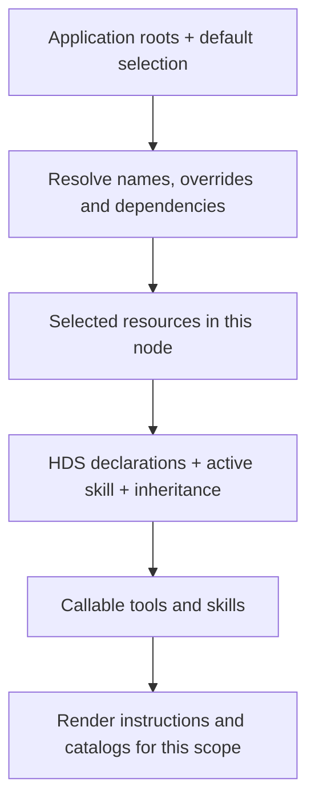

| Configuration | Result and next action |
| --- | --- |
| `default_capabilities=True` | Standard bundled set; without application roots, use bundled `main`. |
| `default_capabilities=False` | Application capabilities only. Supply an HDS and its exit tool; runtime harness tools are not added. |
| `DefaultCapabilities(harness=False, include=...)` | Select individual defaults; include the HDS/exit and dependencies needed by the application. |
| Omitted/`None` | Legacy behavior: supplied application roots plus runtime tools, or the full bundle when no roots are supplied. |
| Loaded tool absent from HDS/skill declarations | Loading alone does not grant scope access. Declare it directly or expose a skill that declares it. |
| Excluded optional resource | Remove its optional declaration and conditional instructions. |
| Excluded required dependency | Initialization fails with the missing dependency; include it or remove/replace its dependent. |
| Named or Python-object override | Keep the target name, use the replacement contract, and update instructions if its workflow changes. |

For example, excluding `delete-file` can leave a usable file skill; excluding
`inspect-file` while retaining the original `read-file` cannot. Use
`<if-tool>`/`<if-skill>` conditions for `direct`, `reachable` or `selected`
availability; conditions neither load a resource nor grant permission.
Required/optional declarations, hook selection and automatic-call override
contracts are specified in [Capabilities](04-capabilities-and-catalog.md).

In the standard `main`, `deep-thinking` and `file-processing` are skill entry
points; their file/research tools become callable inside the appropriate skill.
Selected runtime tools such as `bash`, memory readers and execution control
remain available across skill scopes. Inherited ordinary tools depend on
`inherits-parent-tools`; the bundled file skill sets it to `false`.
By default, internal tool parameter descriptions arrive in the skill's generated
catalog. `parameter_descriptions_in_schema=True` on `DeepAgent` moves them back
to the provider schemas without changing execution.

## 2. Skill lifecycle

### Open, work, exit, continue

Calling a deep skill opens a scope; it does not run a separate agent. The skill
instructions, generated catalog and exit instructions become visible in the
same node's conversation. Existing caller context is available at entry.
Ordinary tools leave depth unchanged; skill entry increases it by one.

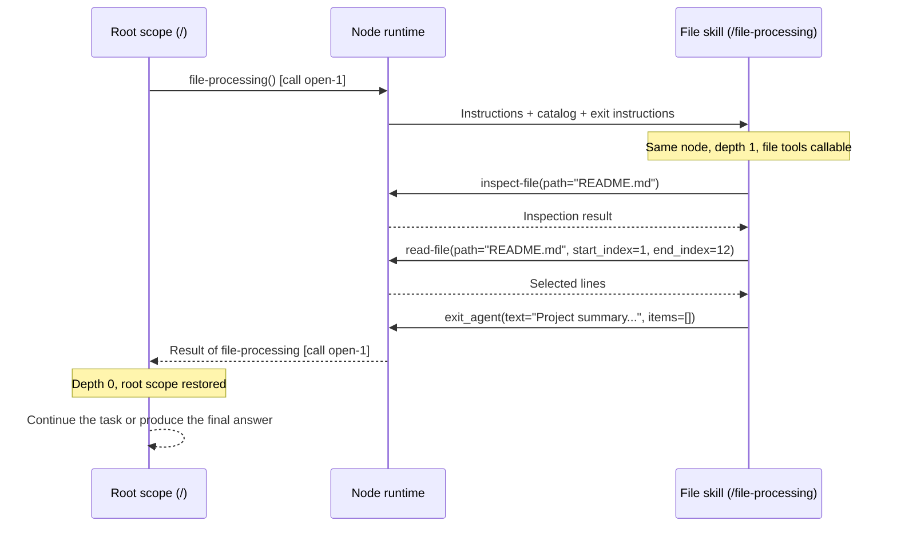

The read range above assumes the inspection reports at least 12 lines. Choose
ranges from the actual report. `exit_agent` is the bundled HDS-selected exit
tool; a custom HDS can select another exit tool with the required result type.

### What the caller sees after exit

The runtime saves the skill transcript in its execution tree, replaces the
skill's active inner history with its final return, and resumes the caller.
The returned tool result belongs to the **opening skill call**, not to a second
late result for the exit call. Steering accepted inside the skill is preserved
in the caller's conversation as user guidance.

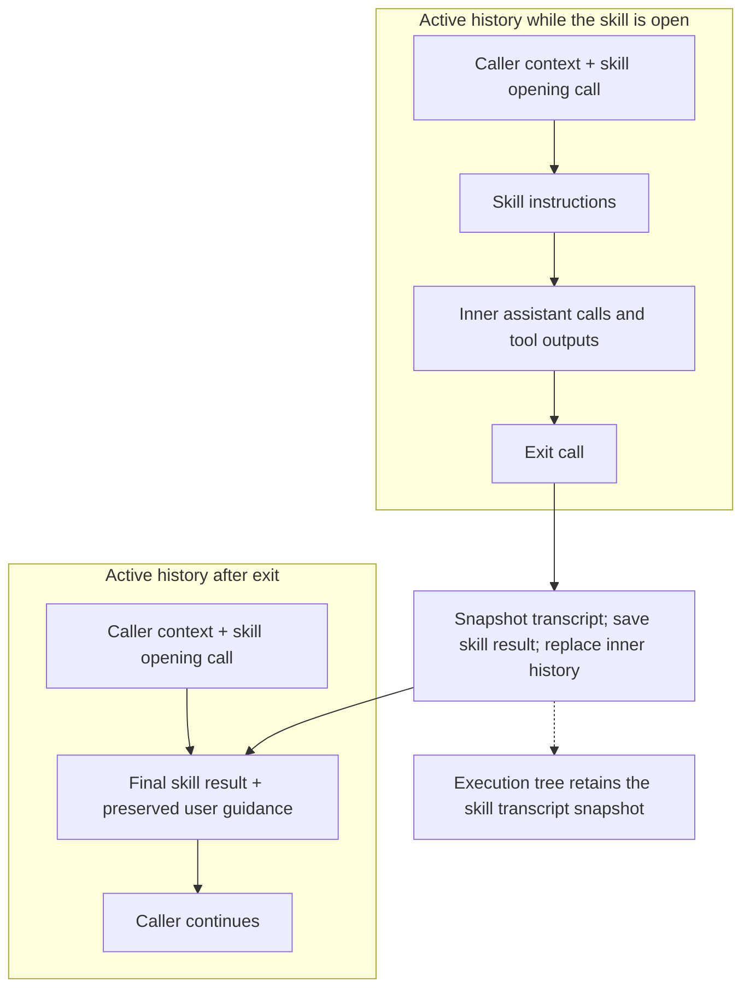

The caller no longer sees all intermediate reads, decisions and errors. Return
the outcome, changes already applied, remaining work and useful output IDs in
`text`. This handoff prevents repeated work. Transcript snapshots are available
to the application through `response.get_history_tree()`; they are not silently
reinserted into model context.

At ordinary root depth `0`, finish with a nonempty assistant answer;
`exit_agent` is not permitted there. At positive depth, the runtime requests
tool use so the model can explicitly exit each scope. A configured positive
initial `Node(depth=...)` also exposes exit without an opening skill snapshot;
each such exit lowers depth, and normal root completion becomes available at
zero. An empty response without calls prompts the model to supply content or
a tool call. See [execution and depth](05-deep-agent-and-execution.md).

## 3. Nested skills and reentry

Nested skills must be declared by their caller. Tool inheritance follows the
active chain; skill entry permissions follow the innermost capability's
declared subskills. An exit closes only the innermost open skill.

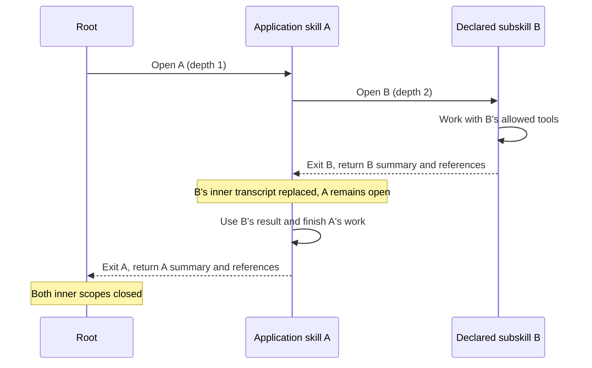

Closing B does not finish A or answer the user. A can select saved, retrievable
outputs from B in its own exit `items`, because B belongs to this invocation's
descendant scope. The two returns have separate output IDs and snapshots.
The names A/B above are application examples, not bundled capabilities.

Reopening A later creates a **new invocation**. The same name, path, depth or
reused provider call ID does not restore the old invocation. Previous saved
results remain node-readable for their lifetime, but they do not become new
work or qualify for the new invocation's exit `items`. Read an existing result
when it already answers the question; reopen a skill when further scoped work
is needed. [Background delivery](#7-managed-work) also distinguishes these
invocations.

## 4. Skill handoff and memory

`exit_agent(text, items)` chooses the information promoted into caller context.
The cache preserves retrievable outputs, not an automatic answer to every
future step. Calling an original work tool again **executes it again**; cache
lookup is explicit.

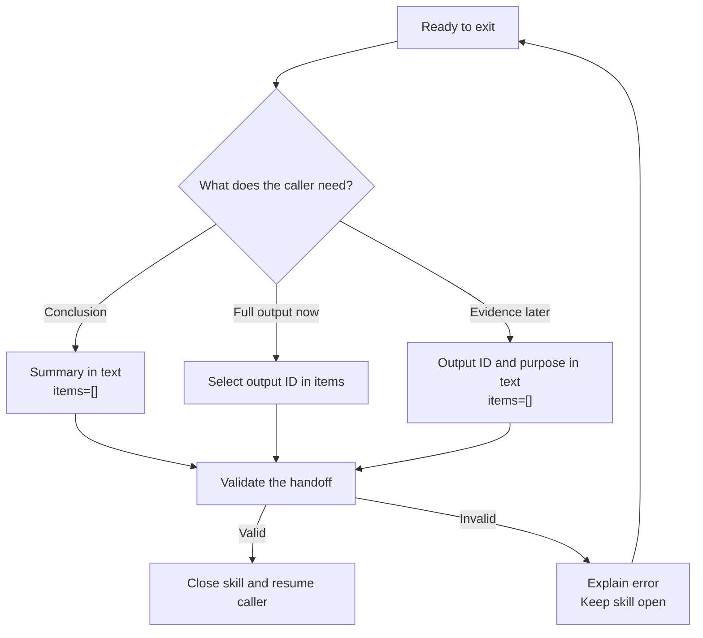

Suppose `result-17` is a saved, retrievable output created in this invocation:

```text
exit_agent(text="Read README.md. It describes a hierarchical agent library. No files changed.", items=[])
exit_agent(text="Evidence: {{result-17}}", items=["result-17"])
exit_agent(text="Summary complete; full evidence is result-17. Read it only if needed.", items=[])
```

`items` without placeholders append selected outputs in list order. A
`{{result-17}}` placeholder must also be listed in `items`. An unambiguous
original call ID is accepted as an alias, but canonical output IDs avoid
ambiguity. Duplicate aliases, missing IDs, outputs from another node or an
earlier invocation, and malformed/unlisted placeholders return an error and
leave the skill open. Memory tools do not cache their own responses and their
read-call IDs are not evidence to select. See [exit items](10-exit-tool-items.md).
An uncached managed result can be read from the runtime but cannot be selected
in `items`; return its ID in `text` when it is needed later in the same runtime.

Every skill return includes `used-tools` references (`name`, `id`) for the
outputs produced in that invocation and its descendants. These references
are an index, not inline copies or a guarantee of continued retrievability;
uncached synchronous outputs, for example, need not remain readable by ID.

When the caller has lost the details:

1. Use `get_execution_history()` for a compact overview of calls and available
   `saved-output-id` values; page with `start_position` when necessary.
2. Use `search_tool_outputs(query=..., tool_name=..., skill_path=...)` to find
   saved or runtime outputs; follow `next_offset` for more results. Skill-path
   filtering is exact. Empty results can mean filters are too narrow.
3. Read the canonical ID with `read_tool_output(output_id="result-17")`.
   Reading works across scopes of the **same node**, not across child nodes.
4. For a large-output manifest, follow the file workflow in
   [section 9](#9-large-outputs). A search preview is not the complete evidence.

`summary_mode="brief"` or `"detailed"` requests a separate model summary;
`"none"` is the default. Results below the configured 300-token threshold are
not summarized. Summary failures fall back to the full representation; summaries
do not replace cache contents or restore file-operation evidence. Details:
[output cache and search](09-tool-call-cache.md).

## 5. Multiple calls

A provider response can request several capabilities. All names are checked
against the scope that generated the response **before any work starts**.
A tool callable only inside a skill cannot be smuggled into the same response
that opens that skill.

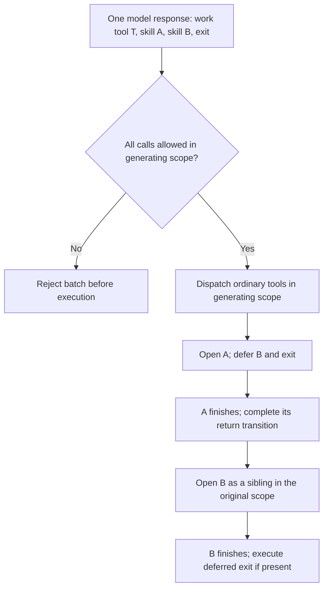

This example assumes an enclosing skill where the exit and both child skills
are permitted. At root, adding an exit would invalidate the batch.
Ordinary tools run first even if an exit was listed first; their managed work
may still be running. Skills run in their requested order. A sibling B is not
silently nested inside A. Deferred calls resume in separate assistant messages
with the generating turn's thinking, preserving complete call/result pairs.
Existing ordinary results in the opening batch survive skill return replacement.

Dependent operations require separate model turns: `inspect-file` and
`read-file` in the same generated batch do not satisfy the read prerequisite,
because the model has not yet seen that inspection. The same principle applies
to read evidence required by an edit.

## 6. Subagents

A child is a separate `Node`, not a nested skill. Nodes in one hierarchy need
unique resolved `agent_context_id` values; direct siblings also need unique HDS
names. `call_sub_agent` selects direct children by HDS name and is normally
available from every parent scope. A leaf has no such tool. Selection can
exclude it.

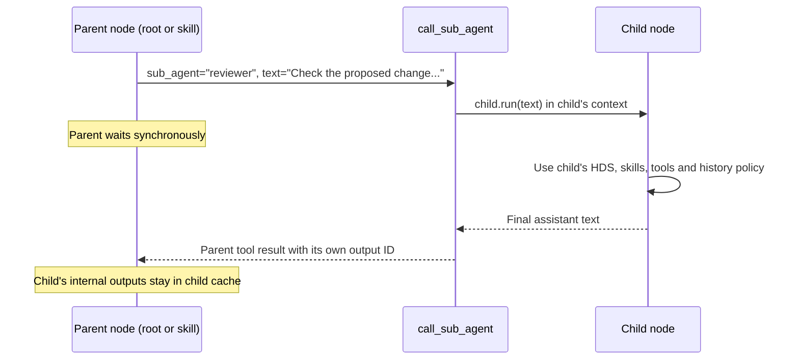

Give the child a self-contained task: goal, constraints and evidence it needs.
The child receives `text` as its new user message, not an automatic copy of
the parent's conversation. A parent's output ID alone is not readable in the
child. The parent receives the child's final text; its cache stores that
delegation result, not the child's whole transcript. Children can delegate
to their own direct children in turn.

This call has no 60-second wait limit or background mode. Root steering waits
until the child returns and does not steer the child. Repeated delegations
follow the child's `persistent_history` setting independently of the parent.
Distinct nodes can share filesystem effects through `work_root`; history/cache
isolation is not a filesystem sandbox. DS4 can use context IDs for engine
checkpoint switching; the library does not guarantee server KV-cache reuse.
See [subagent configuration](05-deep-agent-and-execution.md#3-sub-agent-delegation).

## 7. Managed work

### Short work, expired waits and explicit background

Work tools normally accept `execution_mode="wait"` and `wait_seconds=60`.
The wait must be positive and at most 300 seconds. Expiring it does not cancel
the job. `"background"` returns control immediately. Strict provider schemas
can require these fields with `null` meaning the defaults; use the actual
schema for the configured provider. A node allows at most 16 active jobs.

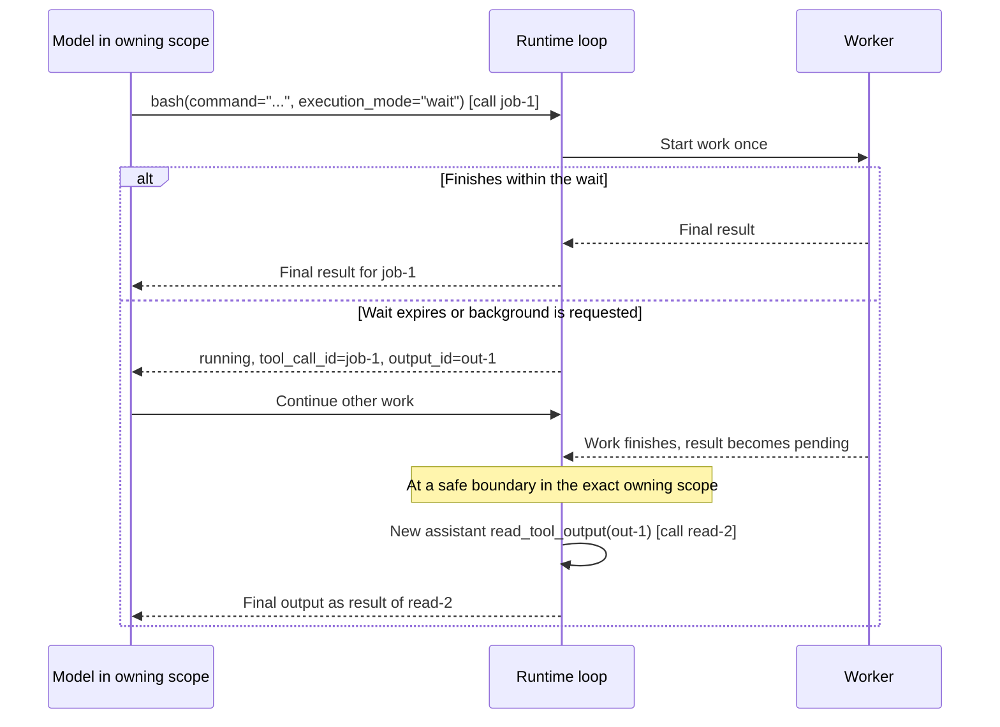

The original call receives exactly one result. Completion never adds a second
result to `job-1`. The worker runs the job; the node loop owns history changes,
cache synchronization and further inference. Work functions and hook state
must support concurrent execution when background calls can overlap.

| Need | Operation | Identifier |
| --- | --- | --- |
| Wait longer | `control_tool_execution(tool_call_id="job-1", action="wait", wait_seconds=10)` | Original job's call ID, not a read/control call ID |
| Request cancellation | `control_tool_execution(tool_call_id="job-1", action="cancel")` | Original job's call ID |
| Read current/full output | `read_tool_output(output_id="out-1")` | Canonical output ID |
| Read only new output | Start with `cursor=0`, then pass returned `next-cursor` | Output ID plus that tool's cursor; only supported tools |

Control returns status and a readable output ID; it does not replace an output
read. Repeated waits and reads do not rerun the work or hooks. A successful
manual final read acknowledges delivery and suppresses a duplicate automatic
read. A preview or partial read does not acknowledge a future final result.
Unsupported cancellation reports that fact and retains the actual status;
generic Python functions cannot be forcibly stopped by this protocol.

`bash` creates a fresh shell per call with `cwd=work_root`. It supports partial
stdout/stderr reads and cancellation of its process tree where supported.
A nonzero shell exit code is a **completed command result** to inspect, not a
runtime `failed` state. A missing executable is an execution failure. Bash does
not silently fall back to another shell or retain a previous call's shell state.

### Leave the owning skill while its job is running

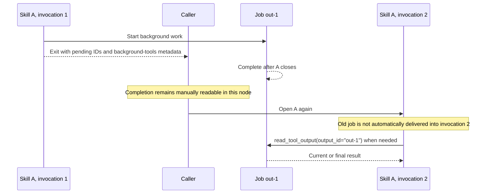

Automatic delivery requires the same node conversation session and exact
opening-skill chain. A job owned by an outer skill can wait while a nested
skill is open and be delivered when that outer scope resumes. A job owned by
an already closed skill is not automatically promoted to root. Returning
pending IDs in `text` lets the caller continue deliberately.

The exit header's `background-tools` lists running jobs from that invocation
and its descendants, with name, original call ID, output ID and skill path.
It is a snapshot at exit. `used-tools` also includes finished outputs; it is a
different index. Excluding `read_tool_output` disables automatic delivery, so
applications must provide another retrieval path. See
[Tool Executions](13-tool-executions.md) for status, cancellation and lifecycle.

## 8. Hooks

Before/After interfaces wrap execution; their arguments are not model-facing
fields. Each gets a private invocation snapshot of business arguments,
workroot and history. The After hook sees effective input values and the
complete result.

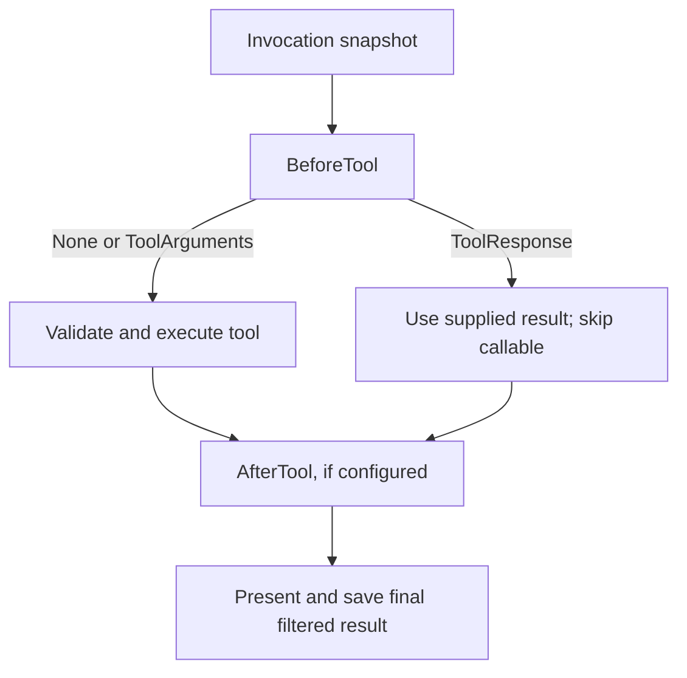

For managed work, each phase runs once in the worker. Reads and control calls
do not repeat the original job's hooks. A configured After hook withholds
partial data until the complete result has been filtered, including Bash
stdout/stderr; raw progress cannot bypass that filter. A hook on a memory or
control tool wraps that separate invocation, not the original job.

An After hook can remove multimodal companions by returning a plain dictionary;
preserve `AttachedToolResult` when attachments are still needed. Hook outputs
must also respect special contracts, such as inspection provenance or exit
`text`/`items`. The application can configure hooks with `ToolHooks` after
overrides without changing the resource's execution restrictions. See
[hook contracts](03-tools-and-structured-outputs.md#before-and-after-hooks).

## 9. Large outputs

The default inline body budget is 5000 model tokens. A larger body is published
as temporary text files and replaced with an XML manifest. This applies to
ordinary results, partial/final managed output, errors, automatic reads and
skill returns after `items` composition. Skill-opening instructions are
execution context and are not externalized by this policy.

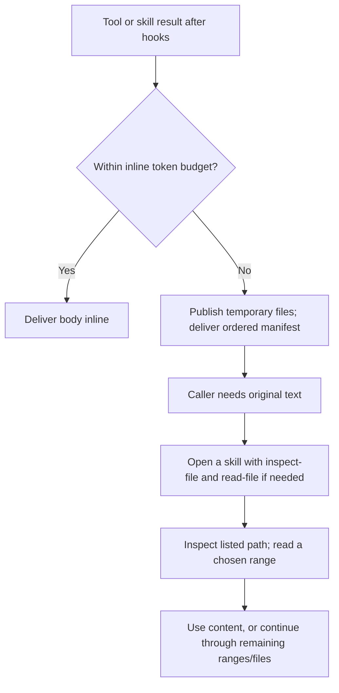

A multiline body stays in one file. A single physical line is split into
token-bounded files; concatenate them in manifest order to reconstruct the
exact body. No newline is added between chunks. If a multiline selection is
too large, request smaller line ranges to avoid exporting the read again.

`read_tool_output`, exit `items`, search and summary reads return the manifest;
they do not automatically open its files. Runtime file access validates
registered artifacts in the same node/session. Paths, identity and content
versions matter: modified, missing or replaced artifacts are not silently
trusted. Copy a needed durable artifact into application-owned storage before
the session closes; these files are temporary, not an archive.

`cache_result=False` prevents a saved JSON result, but does not prevent
temporary-file delivery. Managed uncached jobs remain readable in their
runtime; a synchronous uncached tool can leave only the paths in its response.
An export failure does not prove the original work failed: recover through
its existing ID before rerunning a side effect. Configuration and cleanup:
[Large Tool Outputs](16-large-tool-outputs.md).

## 10. File workflows

### Inspect, choose and read

Text and PDF reads require a successful inspection of unchanged content,
with the real call and full result still visible in this node's history.
Evidence is frozen at the generating batch boundary and revalidated against
the file. Cached reports, summaries, IDs and history removed by skill exit or
explicit compaction do not substitute for that evidence.

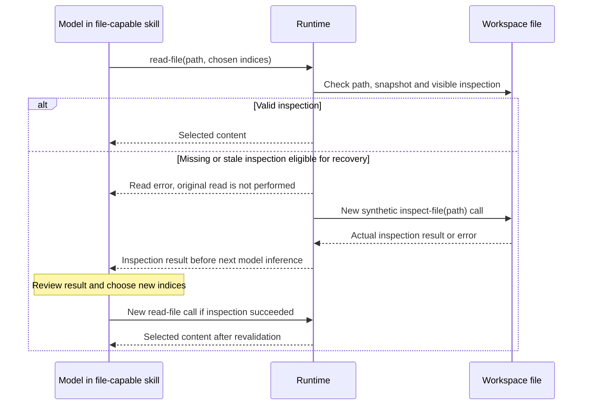

No intermediate inference is needed between the rejected read and its automatic
inspection. The failed read is not retried automatically. If the scope closes
or changes in that batch, recovery does not run in the wrong scope: keep the
skill open until reading succeeds. A failed automatic inspection produces its
own real result, without an automatic retry loop or a fabricated successful read.

For a mixed batch, complete all original read results first, then append
deduplicated inspections for the paths that need recovery. Already successful
reads are not repeated. An unavailable path or unsupported range/format has its
own diagnostic; follow that cause rather than assuming every error is a missing
inspection.

| Input | Reading workflow |
| --- | --- |
| Nonempty text | Inspect, then `read-file(path, start_index, end_index)` with 1-based inclusive physical line indices. No implicit whole-file read or clamping. |
| Existing empty text | Inspect, then use `start_index=0, end_index=0`; success has no lines and can authorize editing that empty file. |
| PDF | Inspect for page count, then select 1-based inclusive pages, at most 5 per call by default. Pages arrive as labeled rendered images, not extracted text/OCR. |
| Supported image | Read directly with required indices conventionally set to `0, 0`; index values are ignored. Deliver the first frame plus XML metadata. |
| Archive | Inspect lists bounded member metadata without extraction. This does not make members directly readable as text files. |
| Limited/truncated inspection | Check warnings, truncation and pagination before claiming complete coverage; do not infer unseen regions. |

Images/PDF pages are real multimodal companions, not image descriptions encoded
as tool text. Saved reads can restore attachments. Provider support and resource
limits still apply. See [File Inspection and Reading](14-file-inspection.md).

### Edit an existing file

An existing text file needs both valid inspection and a subsequent successful
read in visible history. Interactive generation authorizes the file snapshot
before generating its literal replacement; the client still checks the completed
arguments, evidence, hashes and conflicts before writing.

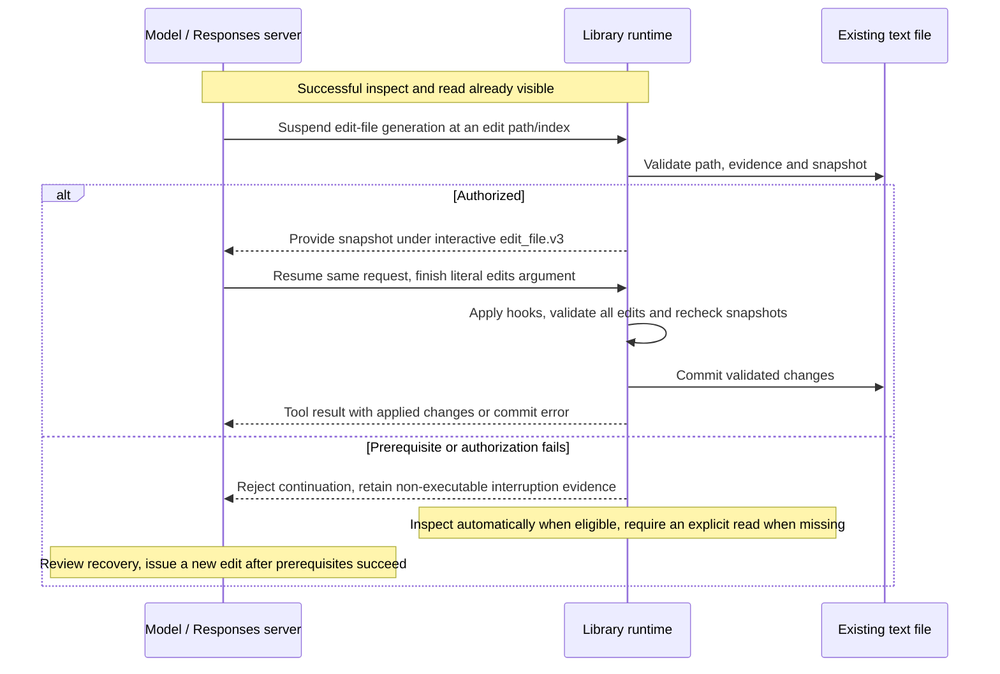

The current argument is a single literal document:

```text
edit-file(edits='<exmekh_edit path="notes.txt" id="427" />old text<exmekh_new_text id="427"/>new text')
```

The server supplies the opening ID after authorization; copy it into the
separator. Bodies preserve exact text, whitespace and line endings. Old text
must start at a physical line boundary, including indentation, and occur exactly
once globally. Insert by keeping an existing anchor in the new text; empty new
text removes the selection while keeping the file. Empty old text is permitted
only for an existing empty file. Tags such as `<all/>` and `<delete/>` have no
command meaning in this format.

Repeated edits of one file refer to the initial snapshot and must not overlap;
the file is committed once. Validation failures prevent writes for the call.
An OS failure between commits to distinct files can leave earlier files changed;
read the reported committed paths and current contents before retrying only the
remaining work. Generation interrupted or rejected before a complete executable
call is not treated as a completed edit. Interactive control messages are provider
protocol, not additional model tool results with invented arguments.

This workflow requires a server supporting the negotiated Responses interactive
contract (`edit_file.v3`, transport version 2); a generic tool-capable endpoint
alone does not supply it. Linux/WSL is the qualified commit runtime. The current
literal protocol supersedes the older edit/create/delete marker and XML-command
designs still described historically in the TODO. Exact framing and boundaries:
[File Editing](15-interactive-file-editing.md).

### Create or delete resources

Creation and deletion are separate operations, with no inspection/read prerequisite:

```text
new-file(document='<new-exmekh-dir path="reports"/><new-exmekh-file path="reports/result.txt"/>Done')
delete-file(paths=["reports/result.txt", "old-build"])
```

Creation processes entries in order; create a parent directory before its file.
Destinations must not already exist, file bodies need at least two Unicode
characters by default, and directory bodies are ignored with warnings. Reserved
opening marker prefixes cannot occur literally in a file body. Document-wide
type/size/element errors prevent all writes; otherwise malformed or failing
entries do not stop later ones or undo earlier successes.

Deletion also continues per path, and directories are recursive. It rejects
the workroot itself, outside paths and directly named symbolic links. A directory
failure can occur after some descendants were removed. For both tools, inspect
each entry's result and retry only the failures after checking current state.
File tools enforce their workspace boundaries; Bash and custom tools need their
own policies. Passing `work_root` alone is not an OS sandbox.

## 11. Research and reasoning

Open `deep-thinking` for the research tools selected in this node. It also
declares optional `inspect-file`/`read-file` access for local evidence; the same
file prerequisites apply. Do not assume this grants write tools or that the
bundled file skill is a declared nested subskill.

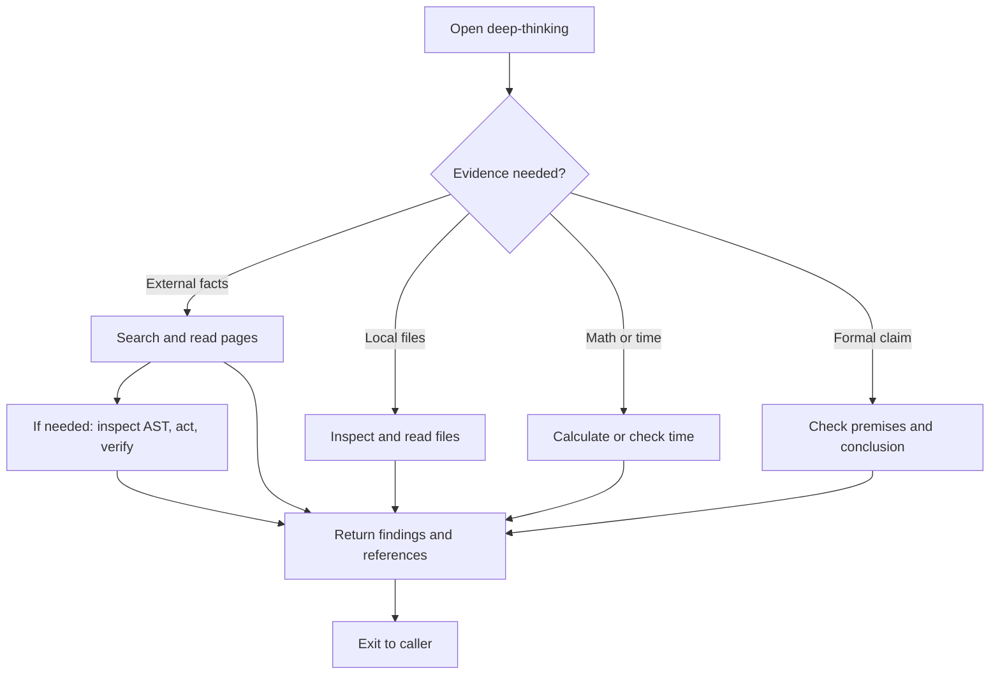

Search snippets identify candidate sources; read a page before citing it.
Browser actions use selectors from an inspected page and report observed
outcomes. An action may have taken effect before a timeout or navigation
rejection, so inspect current state before repeating it. Public HTTP(S), origin
and hop restrictions remain in force. Missing browser/model assets produce
dependency diagnostics or documented ranking fallbacks; check
`visual_ranking_applied` before claiming that image ranking ran.

`calculate` uses typed operations and a limited expression parser, not arbitrary
Python. Formal tools check the supplied formulas: inconsistent premises,
countermodels, unknown and timeout are distinct from proof. `date-time` defaults
to UTC, accepts explicit IANA zones and measures elapsed durations; resolve DST
ambiguity with an explicit offset. None of these tools verifies that the original
natural-language assumptions are true.

Direct calls in `deep-thinking` annotate existing XML headers with provider-exposed
thinking up to 200 tokens, or a separate stateless summary for longer text.
That rule does not extend to a nested application skill merely because its parent
is `deep-thinking`. Ordinary skill-exit annotations retain their 100-token rule.
Thinking may be absent and is not a substitute for the explicit handoff text.
Dependencies, operations and limits: [Deep Thinking](11-deep-thinking.md).

## 12. Steering and inputs

`agent.run(...)` owns the active root loop. From the frontend's other thread or
an event handler, call `agent.steer(...)` to queue additional user guidance.
It returns after queuing; the original `run()` returns the final answer.

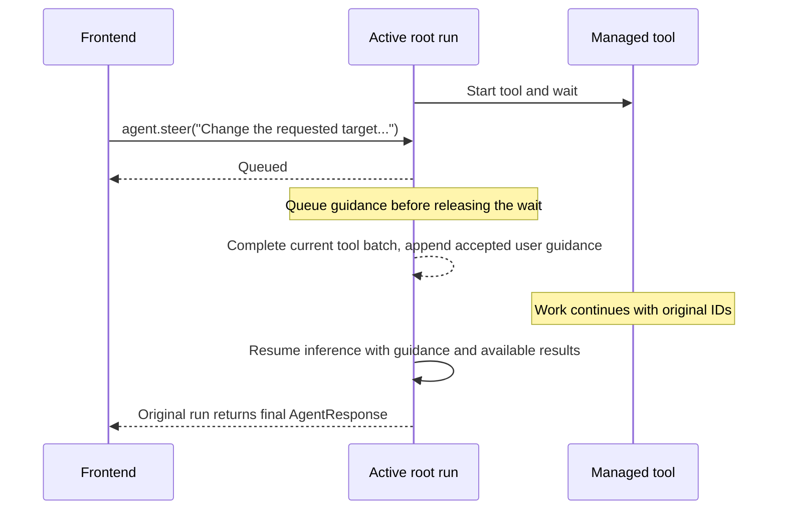

Steering releases managed waits, including execution-control waits, without
canceling work or repeating hooks. During inference or synchronous tools such
as `call_sub_agent`, it waits for the next valid boundary. Accepted messages
are copied and inserted in acceptance order. Guidance inside skills survives
their closure; saved steering references can be recovered with attachments.

An inactive `steer()` or a concurrent `run()` on the same node raises
`RuntimeError`. A job continuing after `run()` returns does not make steering
active. On normal closure accepted guidance is processed first; on failure,
pending guidance is discarded, not replayed in a later run. `DeepAgent.steer`
targets root; use the appropriate node's API for that node's active run.

Both `run` and `steer` accept ordered mixed text/image/file content. Native
document attachments depend on endpoint support; DS4 accepts text/images and
rejects native files. Supply document text or images supported by that endpoint.
An explicit `ProviderRequestRejectedError` removes only newly rejected inputs,
preserving previous context and completed tool results. Other provider failures
keep their existing retry/history behavior. See
[mixed inputs](02-client-and-models.md#mixed-user-content) and
[steering](05-deep-agent-and-execution.md#steering-an-active-run).

## 13. History compaction

Skill exit replaces one completed scope with its return. Explicit history
compaction is a separate application operation on a chosen initialized node:

```python
agent.compact_history(node=agent.root_node)
```

It is not a bundled model-callable tool. An idle node compacts immediately;
an active node queues the request and applies it at a safe boundary. Requests
can release managed waits, leaving jobs running. Child compaction requires
explicitly choosing that child and does not compact its parent's history.

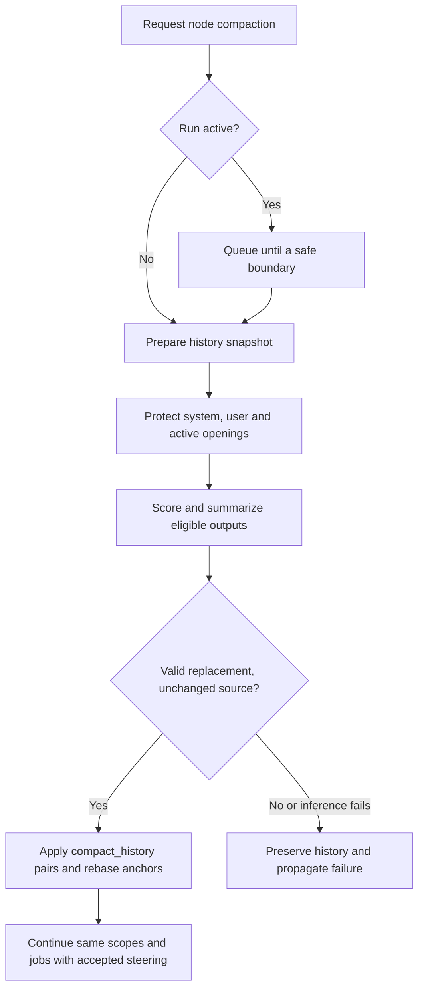

Compaction can replace assistant/tool segments, including state describing
pending work; it preserves system/user messages and protected active-opening
batches. Output scoring uses previews and structured scores; summaries are
model-generated rather than guaranteed exact reconstructions. Saved outputs
and jobs keep their own lifetimes. Full file evidence removed from visible
history must be obtained again before a new file read/edit.

Applications can install a per-node `HistoryCompactionPolicy` and a
`RequestBudget` with known capacity and a complete request-token estimator.
A budget overflow can force compaction, then stops with
`ContextBudgetExceededError` if the resulting request still does not fit.
The library does not infer server capacity. Compaction is not guaranteed to
reduce every history; protected content, existing compacted blocks or long
summaries can limit reduction. Archive/progress events allow the application
to preserve original replaced segments outside model context. Contracts and
scoring rules: [History Compaction](18-history-compaction.md).

## 14. Persistence and recovery

Conversation scope, runtime job registry and cache session are different
lifetimes. A fresh conversation does not imply an empty runtime output store.

| Transition | Conversation and scope | Outputs, work and required action |
| --- | --- | --- |
| Another `run()` with `persistent_history=True` | Continue this node's conversation | Same-scope pending completions can be delivered on the next active loop. |
| Another `run()` with `persistent_history=False` | Rebuild conversation and scope instance | Existing runtime/cache outputs remain manually readable, but old completions are not automatically delivered into the new session. |
| Skill exit and reentry | New skill invocation inside the same node | Old output IDs may be read manually; exit selection and automatic delivery do not treat the old invocation as current. |
| Two nodes with the same HDS/tokenizer session | Separate node identities and conversations | Output IDs are node-local; shared filesystem effects still require coordination. |
| `cache_result=False` work | Normal conversation protocol | Managed results have only a runtime view. Synchronous uncached results need not be retrievable by ID. |
| `Node.initialize()` again | New runtime and node identity | No job restoration or automatic adoption of previous node records. |
| Cache-session closure | Existing model messages can still contain old references | Session files and temporary outputs are removed; history listing omits no-longer-readable saved IDs. |
| Runtime/process restart | No automatic conversation/job continuation | Saved `running` records, if explicitly inspected, are `unavailable`, not successful final results. Check external effects before relaunching. |

Workers can finish after `run()` returns. They do not start an inference on
their own; the next eligible loop boundary handles delivery. Daemon workers
do not guarantee cleanup or cancellation of external resources on shutdown.
Abandoned output-file sessions are cleaned under process locks, preserving
still-active sessions. Treat output IDs and manifests as temporary references.

`Node.restore_history(...)` accepts message objects for persistent nodes and
an optional application restoration callback for execution records/state. It
does not deserialize a JSON dump into a resumable agent, restore active skill
stacks or restart jobs. Inspection provenance is private runtime state, so
imported history is not authorization to read/edit a file without fresh evidence.
History exports remain JSON; they are not durable cache/session backups.

## 15. Errors and observation

Structured model-facing fields use the shared XML renderer for immediate,
background and saved reads. Headers identify capability type (`Tool` or
`DeepSkill`), canonical output ID, response type and execution metadata;
body fields keep their Python names. Tool-authored strings, Markdown and
preformatted output retain their text. Python return values, cache records,
provider tool arguments and history exports remain structured/JSON rather
than being converted into XML internally.

| Observed outcome | Interpretation | Recovery |
| --- | --- | --- |
| Unknown/forbidden capability in a batch | Scope or registration failure before execution | Correct declarations/selection or choose an allowed entry point; the exception is not an individual tool result. |
| `invalid_tool_arguments` | Binding or execution-option rejection | Read required/accepted fields and the correction hint; issue a corrected call. |
| Final result with `ok=false` | Tool ran and reported a domain outcome | Inspect its cause and per-entry results; do not equate `final` with business success. |
| `failed` execution | Callable/hook/launch error | Use `error_kind`, `error_code`, `hint` and `details`; establish effects before retrying. |
| `running`/`partial` | Work is still active | Continue other work, wait or read new output by the existing IDs. |
| Cancellation unsupported or unsuccessful | No confirmed stop | Keep the actual job status; inspect output and wait if needed. |
| Export/delivery error | Work may already have completed | Read existing output/state or inspect affected resources before relaunching. |
| Missing output or stale `running` record | Wrong node/ID, expired storage or unavailable prior runtime | Search this node and check lifecycle; inspect external state rather than inventing a result. |
| Cache/storage/provider failure outside invocation | Infrastructure boundary | The application handles the propagated exception; do not disguise it as a correctable model argument. |

Optional warnings, empty successful searches, ranking fallback and inconclusive
solver results are not interchangeable with execution failure. File/browser
partial effects must be checked before repeating actions. The detailed recovery
catalog is [Tool Error Guidance](17-tool-error-guidance.md).

Use a typed `DeepAgentEventHandler` for provider streaming, execution snapshots,
steering and compaction observation. `TOOL_END` ends that **call attempt** and
can report `running`; inspect execution status for job completion. A skill
return's duration includes nested work. Header times and optional thinking
annotations are metadata, not proof that pending work finished.

`response.history` is the current linear transcript;
`response.get_history_tree()` contains skill execution snapshots for that node,
including nested skills. It is not an automatic aggregate of all child-node
conversations. Obtain child results/history through that child or the
application's event handling. See [event interfaces](12-event-handler-interfaces.md).

## Implementation and verification references

The workflows above follow these owners and deterministic tests. The tests use
controlled providers and real local resources where appropriate; they do not
establish live model behavior, server checkpoint reuse or ranking quality.

| Workflow | Implementation | Representative tests |
| --- | --- | --- |
| Scope and adaptive selection | [Capability composition](../src/exmekh_lib/core/agents/capabilities/default_composer.py), [scope](../src/exmekh_lib/core/agents/node/agentic_scope.py) | [Adaptive capabilities](../tests/core/agents/capabilities/test_adaptive_capabilities.py) |
| Skill entry, exit and mixed batches | [Runtime](../src/exmekh_lib/core/agents/node/node_runtime.py), [executor](../src/exmekh_lib/core/agents/node/tool_call_executor.py), [skill snapshots](../src/exmekh_lib/core/agents/deep_skill/execution.py) | [Node flows](../tests/core/agents/node/test_node.py), [exit items](../tests/core/agents/exit_tool/test_items.py) |
| Child delegation | [Subagent tool](../src/exmekh_lib/capabilities/tools/call_sub_agent/sub_agent_tool.py) | [Delegation](../tests/core/agents/sub_agent/test_sub_agent_tool.py), [child histories](../tests/core/agents/sub_agent/test_sub_agent_history.py) |
| Jobs, IDs, delivery and hooks | [Execution manager](../src/exmekh_lib/core/tool_calls/execution_manager.py), [output runtime](../src/exmekh_lib/core/tool_calls/output_runtime.py) | [Managed work](../tests/core/agents/node/test_tool_executions.py), [background exits](../tests/core/agents/node/test_background_exit_metadata.py), [hooks](../tests/core/agents/tools/test_tool_hooks.py) |
| Large output and recovery | [Output preparer](../src/exmekh_lib/core/tool_calls/output_preparer.py) | [Large output flows](../tests/core/agents/node/test_large_tool_outputs.py), [error guidance](../tests/core/agents/capabilities/test_tool_error_guidance.py) |
| File evidence and interactive generation | [File runtime](../src/exmekh_lib/core/file_inspection/runtime.py), [interactive calls](../src/exmekh_lib/core/file_inspection/interactive.py) | [Read continuation](../tests/core/file_inspection/test_reading_client.py), [edit continuation](../tests/core/file_inspection/test_editing_client.py), [literal operations](../tests/core/file_inspection/test_literal_file_tools.py) |
| Scoped research | [Skill instructions](../src/exmekh_lib/capabilities/deep-skill/deep-thinking.md) | [Research workflow](../tests/core/agents/node/test_deep_thinking_workflow.py) |
| Steering and compaction | [Turn control](../src/exmekh_lib/core/agents/node/turn_control.py), [compactor](../src/exmekh_lib/core/history_compaction/compactor.py) | [Steering](../tests/core/agents/node/test_steering.py), [explicit compaction](../tests/core/agents/node/test_history_compaction.py), [automatic policy](../tests/core/agents/node/test_auto_history_compaction.py) |

Live qualification uses separate opt-in suites described in
[CLI and Testing](07-cli-and-testing.md). The compact instructions and standalone
decision benchmark are described in [Harness Prompts and Evaluation](20-harness-prompts-and-evaluation.md).
These diagrams describe implemented transitions, not a guarantee that a model
will always choose the best next action.
